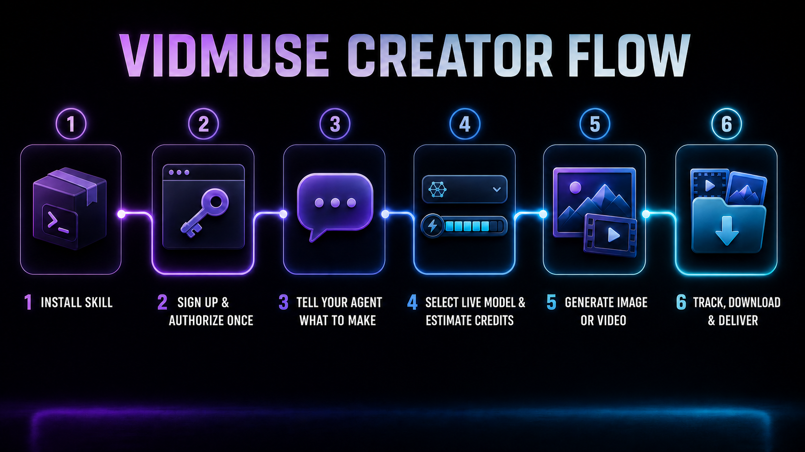
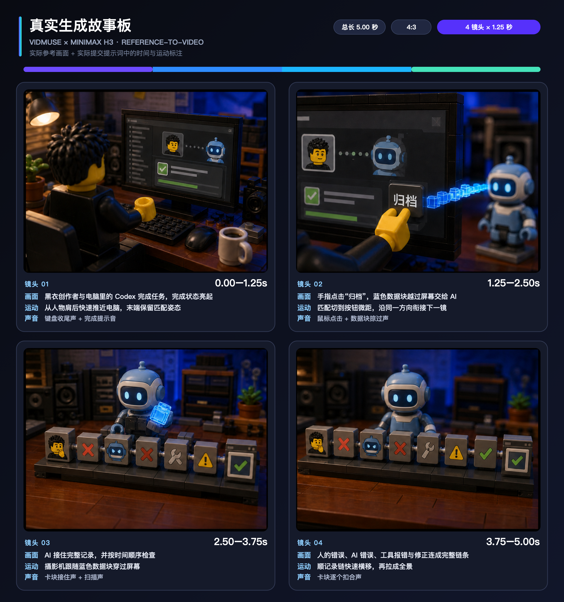

<div align="center">

# VidMuse Video Creator

### 한 번의 인증으로 이미지·영상·B-roll 완성본까지 Agent가 실행

[简体中文](README.md) · [English](README.en.md) · [繁體中文](README.zh-TW.md) · [日本語](README.ja.md)

[멤버십 및 도움](#membership-help)

<a href="https://go.vidmuse.ai/erduo"></a>

[VidMuse 방문 — Erduo 파트너 링크](https://go.vidmuse.ai/erduo)

</div>

파트너 링크로 접속한 뒤 사이트 안내에 따라 가입·로그인, 공식 CLI 설치 또는 요금제 확인을 진행하세요. VidMuse는 이 링크로 이번 협업을 통한 방문을 집계합니다.

## 파트너 및 후원사: VidMuse

이 오픈소스 Skill의 협업과 후원을 지원한 **[VidMuse](https://go.vidmuse.ai/erduo)** 에 특별히 감사드립니다. VidMuse는 계정, 공식 CLI, 클라우드 모델과 생성 서비스를 제공하고, 이 저장소는 그 기능을 Agent가 직접 실행하고 재개하여 결과물까지 납품할 수 있는 워크플로로 정리합니다.

> 위 Logo는 VidMuse 공식 웹사이트에서 가져왔습니다. 저작권과 상표는 VidMuse Team / SandAI에 있으며 이 저장소의 MIT License에 포함되지 않습니다.



이 Agent Skill은 VidMuse 공식 CLI를 설치하고 작동합니다. 브라우저 또는 기기에서 한 번 인증한 뒤에는 Agent가 실시간 모델과 크레딧을 확인하고, 이미지와 영상을 생성하며, SRT 기반 B-roll 제작·비동기 작업 추적·다운로드·납품 기록까지 처리할 수 있습니다.

## 설치

```bash
npx skills add erduo1998-cell/vidmuse-video-creator \
  --skill vidmuse-video-creator \
  -g -a codex -a claude-code --copy -y
```

## 첫 실행

```text
$vidmuse-video-creator를 사용해 최초 설정을 완료하세요.
크레딧이 들지 않는 준비 검사만 하고 유료 생성은 제출하지 마세요.
```

CLI 실행, 유효한 로그인, 요금제 조회, 비어 있지 않은 실시간 이미지 또는 영상 모델 목록이 모두 확인되어야 준비 완료입니다. 인증 정보는 사용자의 CLI 세션에만 저장되며 프로젝트나 Git에 기록되지 않습니다.

## 실제 생성 사례: 스토리보드 → 완성 영상

실제 생성에는 4컷 참조 이미지와 같은 제출 내용에 포함된 시간·화면·카메라 움직임·사운드 지시가 함께 사용됐습니다. 아래 보드는 그 실제 자료를 한 장으로 읽기 쉽게 정리한 것이며 지시 내용을 사후에 새로 만든 것이 아닙니다.

**1. 실제 생성 실행 스토리보드**



[제출 당시의 원본 4컷 참조 이미지 보기](docs/demos/vidmuse-h3-storyboard.png)

**2. 실제 생성 결과**


[4096×3072 납품 예시 다운로드](docs/demos/vidmuse-h3-4k-demo.mp4) · [완성 영상 스틸 보기](docs/images/vidmuse-h3-demo-poster.jpg) · [사례 및 미디어 설명](docs/demos/README.md)

<a id="membership-help"></a>

## 멤버십 및 도움

프로젝트 자료, 영상 사례 또는 제작자의 텍스트 답변이 필요하신가요? Erduo의 「无限涌动 SURGE」는 영구 회원 자격의 Seed 멤버십을 제공합니다. 프로젝트 자료, 영상 사례, 지속적인 업데이트와 커뮤니티 텍스트 Q&A를 이용하고, 본인의 AI를 접근 권한 범위 내에서 회원 자료실에 연결할 수 있습니다. 제공 자료, 혜택과 가격은 웹사이트에서 확인하세요.

[멤버십 혜택 보기](https://erduo.art/site/join) · [가입 / 로그인 후 구매](https://login.erduo.art/purchase/checkout) · [맞춤 서비스 상담](https://erduo.art/site/business)

회원 텍스트 Q&A에는 원격 설치, 기술 문제 해결 대행, 일대일 제작 대행이 포함되지 않습니다. 영상 제작, 배포 환경 구축, 교육 및 별도 라이선스는 범위와 견적을 따로 협의합니다. 멤버십은 이 저장소의 라이선스를 대체하거나 상업적 이용 권한을 자동으로 부여하지 않습니다.

SURGE 멤버십은 VidMuse 계정, 요금제, 생성 크레딧 또는 공식 지원을 대체하지 않습니다. 플랫폼 문제는 VidMuse 공식 지원을 이용하세요. 이 프로젝트는 멤버십 구매 없이 기존 MIT 라이선스로 사용할 수 있습니다. 아래 WeChat QR 코드로 제작자에게 문의할 수도 있습니다.

## 브랜드 및 서비스 범위

VidMuse 상용 서비스, 공식 CLI, 이름과 상표는 VidMuse Team / SandAI가 관리합니다. 이 저장소는 공식 CLI 소스나 공식 지원 채널이 아닙니다.

Skill 협업, 영상 워크플로 또는 상업 프로젝트 문의는 Erduo 개인 비즈니스 WeChat으로 연락할 수 있습니다. VidMuse 공식 고객 지원 채널이 아닙니다.


원본 Skill, 스크립트와 문서는 [MIT License](LICENSE)로 공개됩니다. 상표와 미디어 정보는 [NOTICE.md](NOTICE.md)를 확인하세요.
